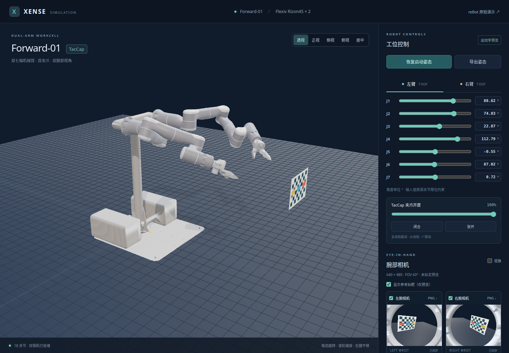

# Xense Description Sim

基于 MuJoCo WASM 与 Three.js 的 Forward-01 双臂可视化工位。默认加载
`forward-01-flexiv-rizon4s-taccap.urdf` 的资产快照：双 Flexiv Rizon4S、双 TacCap
从夹爪、支架和腕部相机。

当前版本提供：

- 左右七轴关节滑块与角度输入，遵循源 URDF 限位。
- 两组夹爪开合及 −1 mimic 联动。
- 左右 TCP 坐标输入、末端点动和三维拖动，支持保持朝向的七轴数值逆运动学。
- 双臂与夹爪关键帧记录、姿态/轨迹导入导出、平滑回放、暂停、停止和进度定位。
- 从源配置恢复启动姿态，导出弧度制关节状态和相机位姿 JSON。
- 主视角旋转、缩放、平移，以及正视、侧视、俯视和模型居中。
- 左右腕部 640×480 相机预览、暂停、视锥查看，以及 PNG 截图。
- 可关闭的参考标靶，便于检查两路图像。原 reBot 演示保留在 `rebot.html`。



## 文档导航

- [使用指南](docs/usage.md)：首次启动、界面操作、相机与姿态导出、部署及排障。
- [技术路线与验收](docs/flexiv-visualization.md)：资产依赖、生成流程、坐标和验证范围。
- [TCP 与关键帧阶段记录](docs/phase-3-control.md)：控制实现、速度约束与验证。
- [Web 开发说明](web_mujoco/README.md)：脚本、环境变量与维护入口。
- [贡献与 Agent 约定](AGENTS.md)：目录、风格、检查和提交要求。
- [原 reBot 参考](README_REBOT.md) / [中文参考](README_REBOT_ZH.md)：初始工程的 ROS、Gazebo 和 AGV 文档。

## 本地运行

后续开发与 Git 操作统一在 `/home/xense/src/xense-description-sim` 中进行。
`/home/xense/src/reBot_RS_Sim` 仅作为初始版本参考。

使用 **Node.js 22.20+**，推荐 Node 22 的最新补丁版本：

```bash
cd /home/xense/src/xense-description-sim/web_mujoco
npm ci
npm run dev
```

打开终端打印的地址，通常为 `http://127.0.0.1:5173/`。模型和运行所需资产均在仓库内，
日常启动无需 Python、ROS、原始资产仓库或实体机器人。

首次克隆、系统仍使用 Node 18 时的启动方式，以及指定端口的方法见[使用指南](docs/usage.md#获取与启动)。

```bash
npm run build
npm run preview
```

构建同时生成默认双臂页面及 `rebot.html`。子目录部署可设置
`GITHUB_PAGES_BASE=/xense-description-sim/`；如需只使用站内 WASM，构建时设置
`VITE_MUJOCO_WASM_CDN=local`。子目录构建和预览必须使用相同的 base，完整命令见
[构建与部署预览](docs/usage.md#构建与部署预览)。

## 目录

| 路径 | 内容 |
| --- | --- |
| `assets/xense/` | 选定的原始 URDF、网格、MTL、启动姿态、来源声明及 SHA-256 清单 |
| `tools/import_flexiv_assets.py` | 递归导入和独立校验资产 |
| `tools/build_flexiv_model.py` | 从快照派生 MJCF、材质分组网格和网页模型配置 |
| `rebotarm_mujoco_rs/models/flexiv_forward_01_scene.xml` | 生成的运动学预览场景 |
| `web_mujoco/src/flexiv-*` | 双臂控制、渲染、模型配置和页面入口 |
| `web_mujoco/tests/` | Chromium 页面集成检查 |
| `docs/flexiv-visualization.md` | 资产、坐标、成像处理及验收说明 |
| `docs/usage.md` | 操作步骤、导出字段、部署和排障 |
| `README_REBOT.md` | 初始 reBot 工程的 ROS、Gazebo 和模型维护文档 |

## 资产导入与再生成

只有更新源资产时才需要原始 `xense-description` 仓库：

```bash
python3 tools/import_flexiv_assets.py /path/to/xense-description
python3 tools/import_flexiv_assets.py --check
```

脚本只读取源工程，并记录实际工作区文件的哈希；提交号不替代未提交文件的来源记录。
本快照共 61 个文件，原始网格、材质和 URDF 按原字节保留。

重新生成模型及运行跨格式检查需要 Python 环境：

```bash
python3 -m venv .venv
.venv/bin/pip install -r tools/requirements-flexiv.txt
.venv/bin/python tools/build_flexiv_model.py
.venv/bin/python tools/build_flexiv_model.py --check
.venv/bin/python tools/check_flexiv_kinematics.py
```

## 检查

在 `web_mujoco/` 中运行：

```bash
npm run test:flexiv
npm run test:flexiv:motion
npx playwright install chromium
npm run test:flexiv:browser
npm run build
```

WASM 检查覆盖双臂独立性、关节限位、夹爪耦合、复位、相机坐标、TCP 求解和关键帧回放。
浏览器检查覆盖实时图像、PNG/JSON 下载、TCP 三维拖动、轨迹导入回放及移动端布局。
支持通过 `CHROMIUM_PATH` 指定已有 Chromium，通过 `FLEXIV_BASE_URL` 检查已运行的开发或生产预览。

日常 Git 同步使用 `origin`，目标为公开仓库
[`FZAbiding/xense-description-sim`](https://github.com/FZAbiding/xense-description-sim)。
`upstream` 保留初始工程来源；工作流程见[Git 同步](docs/usage.md#git-同步)。

## 验证范围与来源

当前是**外观与运动学预览**，使用 `mj_forward` 更新状态；未加入动力学执行器或接触抓取。
源相机安装坐标尚未标定，60° 垂直视场角是预览参数。源光学节点位于外壳内部，
网页仅在各相机画面中隐藏其自身外壳，不修改安装位姿。标靶属于显示辅助，不代表实测工作台。

各资产沿用随快照保存的来源和许可状态，不能用工具代码许可证替代几何资产的原有条款。
详见 [资产快照说明](assets/xense/README.md) 和 [实现说明](docs/flexiv-visualization.md)。
