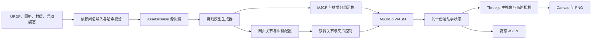

# Forward-01 资产接入与可视化

## 工作与 Git 入口

唯一开发目录为 `/home/xense/src/xense-description-sim`；`origin` 为
`https://github.com/FZAbiding/xense-description-sim.git`，`upstream` 保留初始工程来源。
旧 `reBot_RS_Sim` 目录只作初始版本参考。完整 Git 历史、`AGENTS.md`、资产和实现记录
均在新工程中维护。`xense-description` 作为只读资产来源；日常运行使用仓库内快照。

用户操作、导出字段和部署命令见[使用指南](usage.md)。

## 技术路线



生成阶段从 URDF 获取模型结构与参数，运行阶段使用已提交的派生文件。
浏览器本地完成运动学、渲染和文件导出；当前 Forward-01 不依赖 ROS 或后端服务。
原 reBot 的 ROS 2、Gazebo 和导航能力作为独立路径保留，不能视为已接入 Forward-01。

## 资产边界

导入入口为 `forward-01-flexiv-rizon4s-taccap.urdf`，包含 42 个 link、23 个固定关节、
18 个转动关节。14 个为机械臂关节；四个手指关节包含两个 −1 mimic 从动关节。
依赖闭包包括 31 个网格、9 份 OBJ 材质文件，以及启动姿态、来源与许可证资料，
共 61 个文件、约 25.35 MiB。清单记录每个实际输入的 SHA-256。

`assets/xense` 保留源字节与相对路径。运行资源在 `rebotarm_mujoco_rs/models`，
由 `tools/build_flexiv_model.py` 生成。STL 按原字节复制；OBJ 按源材质拆分、压缩索引，
保留顶点坐标与面，重新生成法线，以兼容 MuJoCo 网格加载并保留白色盖板和金属部位的区别。
派生过程与哈希写入 `derived-manifest.json`，不覆盖原始网格。

源工作区存在未提交文件，故来源提交号仅用于定位仓库历史，实际输入以逐文件哈希为准。
复制的注册文件只作为来源快照，不能按完整资产注册库使用。

## 运动学与界面

生成器逐项保留 URDF 的父子连接、关节原点、轴向、限位、visual origin 和 mesh scale。
惯性张量按其源坐标旋转到 body 系，不推算缺失物性。工位启动角从独立配置由度转弧度，
不写入关节原点。当前运行仅设置 `qpos` 并调用 `mj_forward`，不执行 `mj_step`。
模型没有新增执行器或接触几何；源碰撞网格保存在快照中供后续阶段使用。

默认页面提供双臂分组、七轴滑块和角度输入、关节限位、双夹爪联动及启动姿态复位。
顶部相机条承载两路腕部预览和待接入的头部相机占位；主视图下方同时显示两臂 TCP 坐标，
每臂有明确的独立拖动按钮，自动同步右侧编辑对象。回放与进度位于底部，右侧只保留参数与关键帧编辑。
TCP 的数值 IK 为本仓库自行实现的阻尼最小二乘求解器，不是 Flexiv 官方 IK；MuJoCo 提供正运动学与关节数据。
主视角支持轨道旋转、缩放、平移、四种视角和居中。导出的 JSON 使用弧度制，包含关节状态、
源 URDF 哈希和两个渲染相机的位姿及投影信息。
字段单位、旋转矩阵方向，以及相机暂停后图像与当前位姿的区别，见
[导出姿态与坐标解释](usage.md#导出姿态与坐标解释)。

旧 reBot 页面位于 `rebot.html`，沿用原有入口和模型；Vite 同时构建两个页面。

## 两路相机

相机分别绑定 `left_tool_taccap_camera_optical_link` 与
`right_tool_taccap_camera_optical_link`。源光学坐标的 +Z 向前、+Y 向下，
渲染相机的 −Z 向前、+Y 向上，因此相机局部坐标绕 X 轴旋转 π。
光心位置保持不变。两路画面从同一份 MuJoCo 状态取样，分辨率为 640×480，
最多每 100 ms 更新一次；静止时保留已有图像，避免重复渲染。

浏览器共用一个 WebGLRenderer，将两路相机渲染到独立 RenderTarget，
读回 RGBA 像素并翻转行顺序后显示在 Canvas。PNG 从对应 Canvas 导出。
轨道辅助线、坐标轴和相机视锥只在主视角显示。

实际射线检查发现源光心前方约 22.95 mm 处仍有自身外壳表面。为避免未标定的
外壳遮挡整个画面，网页通过渲染层只对各自相机隐藏自身外壳；主视角和另一相机仍可见。
该处理没有改变源光学安装变换。原生 MuJoCo 渲染尚未应用此网页显示过滤。

双相机使用 60° 垂直视场角作为预览参数；没有声称具有真实内参、畸变或手眼标定。
参考标靶是 Three.js 显示辅助，可关闭，其坐标不代表实测工作台或动力学物体。

## 验证命令与边界

```bash
python3 tools/import_flexiv_assets.py --check
.venv/bin/python tools/build_flexiv_model.py --check
.venv/bin/python tools/check_flexiv_kinematics.py
cd web_mujoco
npm run test:flexiv
npm run test:flexiv:browser
npm run build
```

独立 URDF 正向运动学检查对比启动姿态与五组固定种子姿态下全部 42 个 link，
位置和旋转容差为 1e-10。WASM 检查直接使用浏览器同版本引擎；浏览器检查覆盖
双臂独立控制、夹爪耦合、复位、图像变化、截图和 JSON 下载及窄屏布局。
这些检查不等同于动力学、抓取接触、全行程干涉或实机相机标定验收。

## 阶段边界

| 阶段 | 当前交付或后续要求 |
| --- | --- |
| 资产接入 | 已交付依赖快照、来源与许可记录、内容哈希、可搬移路径和模型生成工具 |
| 可视化版本 | 已交付双七轴控制、双夹爪联动、源启动姿态、双腕部画面和文件导出 |
| TCP 与关键帧控制 | 已交付末端点动、三维拖动、七轴数值 IK、关键帧文件和按源速度限值回放；见[阶段记录](phase-3-control.md) |
| 动力学与抓取 | 后续需验收惯量、碰撞、接触、执行器参数、控制器、工作台与任务物体 |
| 实机或数据采集 | 后续需相机型号与驱动、真实内外参、统一采样时间和帧编号；当前网页截图用于人工检查 |

## 本次验收记录（2026-10-20）

- 61 个源文件的哈希和递归依赖路径检查通过；派生模型再生成一致性检查通过。
- Native MuJoCo 3.12.0 与网页 WASM 3.12.0 均成功加载场景；独立 URDF/MJCF 运动学对比通过。
- WASM 启动姿态、双臂独立性、限位、mimic、复位及光学坐标转换检查通过。
- Chromium 三项集成检查通过，覆盖桌面操作/图像下载、移动端布局及原 reBot 页面加载。
  该轮检查针对 `/xense-description-sim/` 子目录下的生产构建，使用本地 WASM。
- 原有 `test:loading`、`test:reset`、`smoke` 检查通过。
- `npm run build` 和 `git diff --check` 通过。

预览截图：[主页面](previews/forward-01.png)、[左腕 640×480](previews/forward-01-left-wrist.png)、
[右腕 640×480](previews/forward-01-right-wrist.png)。截图包含可关闭的参考标靶。
