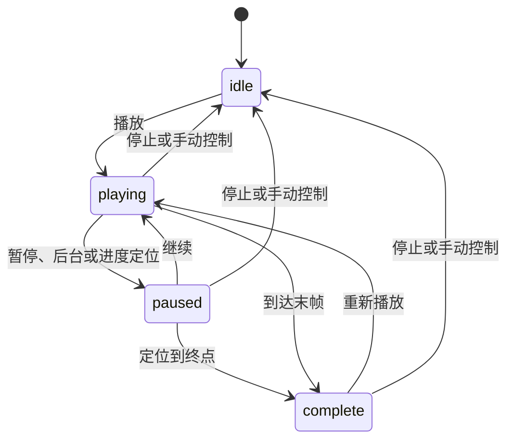

# 下一阶段：双臂 TCP 控制与关键帧回放

## 目标与实施顺序

在已完成的资产接入和可视化上，先交付后续抓取所需的运动学控制基础：

1. 从源 EEF 节点显示左右 TCP 位置，增加数值目标和三维拖动。
2. 为七轴机械臂实现带阻尼、关节限位和可选朝向保持的数值逆运动学；求解失败保留原姿态。
3. 记录双臂及夹爪关键帧，支持 JSON 导入/导出、平滑回放、暂停、继续、停止和进度定位。
4. 从源 URDF 导出关节速度限值，回放自动延长片段时长以符合这些限值。
5. 完成真实 WASM 与 Chromium 验证，更新使用指南并同步 Git。

该阶段仍使用运动学预览。碰撞规划、动力学控制和接触抓取在这套控制入口上继续接入；
不把任意执行器增益或摩擦参数写成已验证的实机物性。

## 实现

### 源模型与原子更新

生成器从源 URDF 的 `limit.velocity` 提取所有 18 个关节的速度限值，单位为 rad/s。
`flexiv-model.json` 的 `arms` 明确列出左右七轴组和各自的 `*_tool_taccap_eef_link`。
没有修改源 URDF、网格、启动角或 EEF 安装位姿。

`flexiv-control.js` 的批量姿态更新先验证全部关节值和 mimic，再一次性提交。
未知关节、非有限数或错误联动不会产生部分更新。姿态未变化时复用当前运动学与渲染状态，
避免静止关键帧重复刷新两路图像。

### 七轴逆运动学

该求解器由本仓库自行实现，不是 Flexiv 官方 IK 库，没有调用 Flexiv 实机 SDK。
MuJoCo 提供正向运动学、关节轴和锚点；迭代与线性求解由 JavaScript 实现。

`flexiv-ik.js` 使用独立 `MjData`，按当前完整场景状态初始化求解。
平移雅可比列由世界关节轴 `a`、关节锚点 `c` 和 TCP 位置 `p` 计算为 `a × (p - c)`；
旋转部分使用世界关节轴。朝向误差采用 `SO(3)` 对数，覆盖接近 π 的旋转。

求解使用带阻尼的最小二乘、步长限制、回溯和源关节限位。
默认最多 100 次迭代，位置阈值 0.5 mm，朝向阈值 0.01 rad。
保持朝向可关闭，拖动时则锁定该次拖动开始时的朝向。
只在成功后应用所选臂的七个角度；失败保留实时场景，另一臂与夹爪不受影响。
这是基于当前姿态的局部求解，失败表示本次没有达到容差，不是全局可达性证明。
求解器内部步长用于数值稳定；连续播放的速度限制由回放模块单独实现。

Three.js `TransformControls` 提供世界坐标轴和平面拖动。TCP 点、坐标轴和拖动器
使用主视角辅助层，不进入腕部图像。拖动期间禁用轨道操作，结束后恢复。
左右 TCP 标签以 DOM 覆盖层跟随投影，标明源模型侧别；导出的 PNG 仅包含渲染画面。

### 双臂交互布局调整

- 上方相机条同时显示两路腕部预览，第三槽标为头部相机待接入；保持真实图像源数量为二。
- 中间为三维视图，下方两张 TCP 卡片同时显示实际世界坐标，各有独立拖动按钮。
- 直接点击任一臂按钮即选择该臂并启用拖动，另一臂按钮取消高亮；右侧标签同步。
  再点当前按钮或按 Esc 退出；切换右侧标签也会更新已有拖动器。
- 回放按钮、进度和反馈移到主区下方，右侧保留关节、TCP 数值目标与关键帧编辑。
- 窄屏上两路腕部仍位于三维视图上方，头部占位压缩为一行，双 TCP 坐标并排保留。

### 关键帧文件与回放

`flexiv-motion.js` 负责独立于界面的文件校验和回放状态机。
导入兼容原姿态 JSON、新版 `xense-pose` 和 `xense-waypoints`，校验源哈希、模型、单位、
完整关节集合、有限值、范围、mimic、帧数与时长。错误文件不改变已有列表或场景。
文件最多 1 MiB、100 帧，单段请求时长为 0.1–120 秒，总计划时长最多一小时。

每段使用 `s(u) = 10u³ - 15u⁴ + 6u⁵` 的关节插值，端点速度和加速度为零。
其最大一阶导数为 1.875，故时长取请求值与各关节 `1.875 × |Δq| / velocity_limit` 的最大值。
这里包括 mimic 从动关节的限值。速度边界针对连续播放，不适用于进度直接定位。



停止保留当前姿态；手动关节、夹爪和 TCP 控制会中止回放。
切到后台自动暂停；长帧单次最多推进 250 ms，避免补跑整段后台时间。
该时间轴是网页预览时间，不是采样数据集的同步时钟。

## 操作与边界

使用[末端 TCP 控制](usage.md#末端-tcp-控制)和[双臂关键帧与回放](usage.md#双臂关键帧与回放)。
新版姿态导出还包含左右 EEF 在世界坐标中的位置与旋转。
求解结果和关键帧文件不代表经过碰撞规划或动力学验证，不能据此声称已完成接触抓取。

后续抓取阶段需要验收碰撞代理、惯性、执行器和控制器，再加入工位与任务物体；
实机相机或连续视觉数据采集另需标定、设备驱动和统一帧时间。

## 验证入口

```bash
python3 tools/import_flexiv_assets.py --check
.venv/bin/python tools/build_flexiv_model.py --check
.venv/bin/python tools/check_flexiv_kinematics.py
cd web_mujoco
npm run test:flexiv
npm run test:flexiv:motion
npm run test:flexiv:browser
npm run build
```

WASM 检查覆盖双臂位置/朝向 IK、不可达目标、原子失败、文件兼容与拒绝、
五次插值速度和关节范围、暂停/继续/停止/定位。
Chromium 检查实际鼠标拖动、数值目标和点动、无效目标回退、关键帧导入导出及回放，
并保留双相机、PNG、移动端和原 reBot 页面回归。

## 验收结果（2026-10-20）

本阶段已完成并通过本地验收：

- 61 个源文件的哈希和递归路径检查通过，源资产没有修改。
- 派生模型再生成一致性检查通过；源速度限值检查和全部 42 个节点的独立 URDF/MJCF 运动学检查通过。
- 基础 WASM 和控制/回放 WASM 检查通过，包括已提交示例文件的兼容性校验。
- Chromium 六项完整检查通过，包括实际鼠标依次拖动右臂、左臂、右臂，校验另一臂与夹爪保持原值，
  以及独立按钮、Esc、双 TCP 同屏坐标、上方相机布局、下载、回放、移动端和原 reBot 入口。
  浏览器检查使用 `/xense-description-sim/` 生产子目录和站内 WASM；另检查了 1366、1024、390 像素宽度无横向溢出。
- 生产构建与文档链接、差异空白检查通过。

[控制界面截图](previews/forward-01-control.png) · [可导入双关键帧示例](examples/forward-01-waypoints.json)

参考：[MuJoCo 数据结构](https://mujoco.readthedocs.io/en/stable/APIreference/APItypes.html#mjdata)、
[Three.js TransformControls](https://threejs.org/docs/pages/TransformControls.html)。
